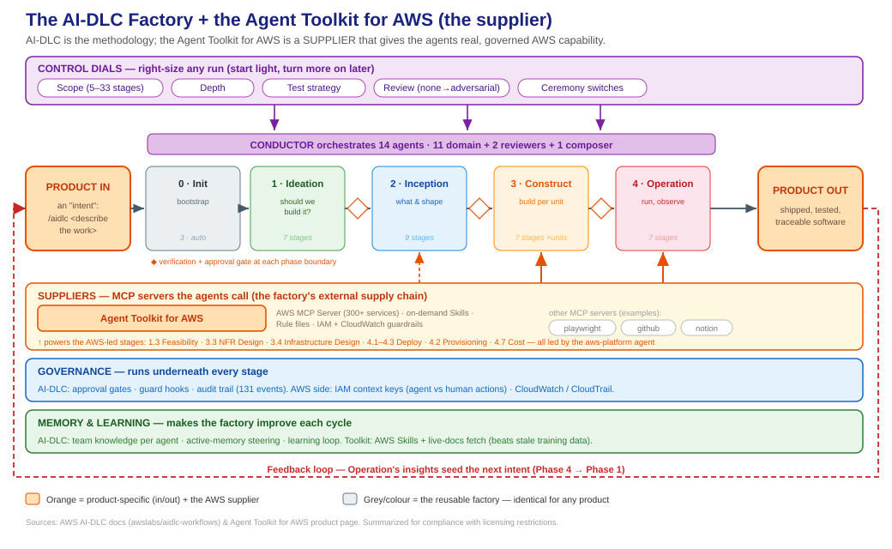
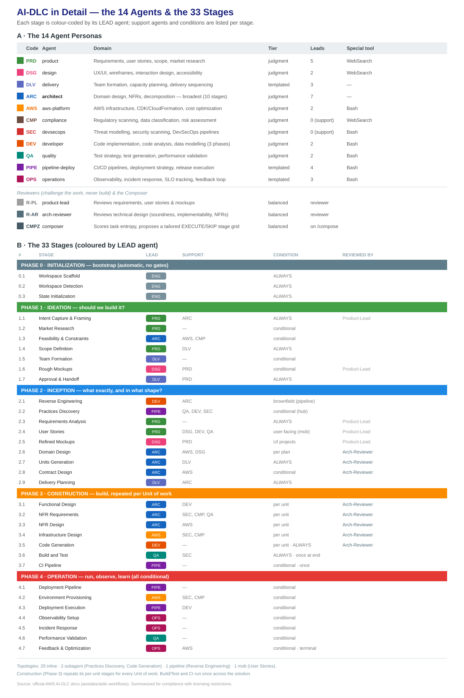
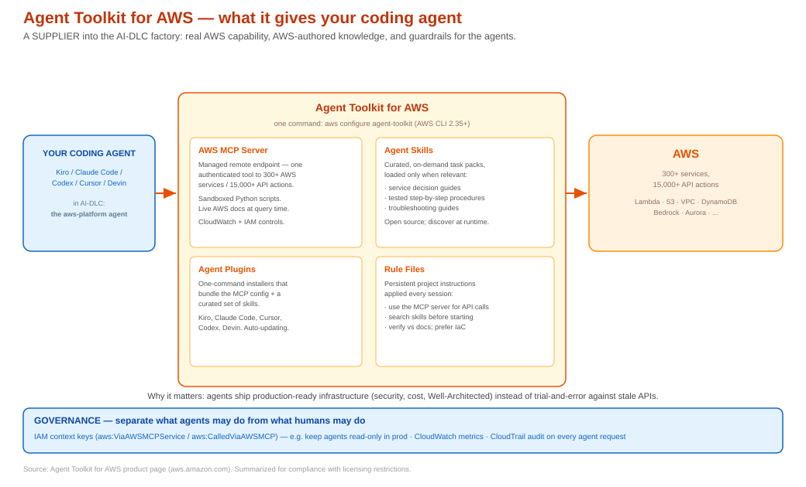

# AI-DLC Supply Chain

How we run **AWS AI-DLC** inside **Kiro** as a *product-independent software factory*. This repo is orientation material so anyone joining a project can get up to speed fast on *how we build*, independent of *what* we're building.

> **Product-agnostic by design.** Nothing here is tied to a specific product. The factory is the same whatever we build on top of it; a product enters only as an "intent".

## TL;DR
- **AI-DLC** is an open methodology from AWS: **5 phases, 33 stages, 14 agents**, with human approval gates. It's the *how we build*.
- We run it inside **Kiro IDE**. A piece of work enters as an intent: `/aidlc <describe the work>`.
- **Start light** (`/aidlc express`) and **dial up** toward `enterprise` as the work gets more serious.

## The factory at a glance

*Click the diagram to open it full size.* Only the two orange ends are product-specific. Everything between is the reusable factory. Three cross-cutting layers run underneath: **Control dials** (right-size each run), **Governance** (gates, guards, audit), and **Memory** (team knowledge + a learning loop). An external **supplier** layer (MCP servers such as the Agent Toolkit for AWS) gives the agents real, governed capability.

## The agents & stages, in detail

The same pipeline, exploded: all **14 agent personas** (11 domain experts + 2 reviewers + 1 composer) and the **33 stages**, colour-coded by the agent that leads each, with its support agents, run condition, and reviewer coverage.

*Click the diagram to open it full size.* A single **conductor** orchestrates all delegation — agents never call each other. The **architect** is the busiest (10 stages); **compliance** and **devsecops** only ever support, never lead. Phase 3 (Construction) repeats its per-unit stages for every Unit of work.

## The AWS supplier: Agent Toolkit for AWS

AI-DLC decides *what* to build and *in what order*; the **Agent Toolkit for AWS** makes the "build it on AWS" steps competent, current, and governed. It's a supplier that plugs into the factory — it gives the agents (notably the `aws-platform` agent) real AWS capability, AWS-authored knowledge, and guardrails.

*Click the diagram to open it full size.* Four parts: **AWS MCP Server** (one authenticated endpoint to 300+ services, sandboxed scripts, live docs), **Agent Skills** (on-demand task packages), **Agent Plugins** (one-command install for Kiro and others), and **Rule Files** (persistent "work with AWS this way" instructions). Governed by **IAM context keys** (scope agent actions, e.g. read-only in prod) and **CloudWatch / CloudTrail** auditing. Set up with one command: `aws configure agent-toolkit` (AWS CLI 2.35+). See the [product page](https://aws.amazon.com/products/developer-tools/agent-toolkit-for-aws/).

## Set it up

See **[docs/setup-kiro-windows.txt](docs/setup-kiro-windows.txt)** — a Windows setup guide plus the full functional hierarchy (Appendix A) and scope scenarios (Appendix B).

**Prerequisites:** Kiro IDE >= 1.1.70, Claude Opus 4.8 (paid Kiro plan).

## Suggested reading order
1. This README — the concept
2. `diagrams/02-factory.svg` — the big picture
3. `diagrams/03-agents-and-stages.svg` — the detail
4. `diagrams/04-aws-toolkit.svg` — the AWS supplier
5. `docs/setup-kiro-windows.txt` — install + reference

---
*Sources: AWS AI-DLC docs (awslabs/aidlc-workflows) and the Agent Toolkit for AWS product page. Content summarized for compliance with licensing restrictions.*
